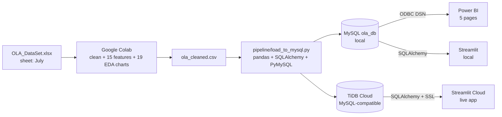
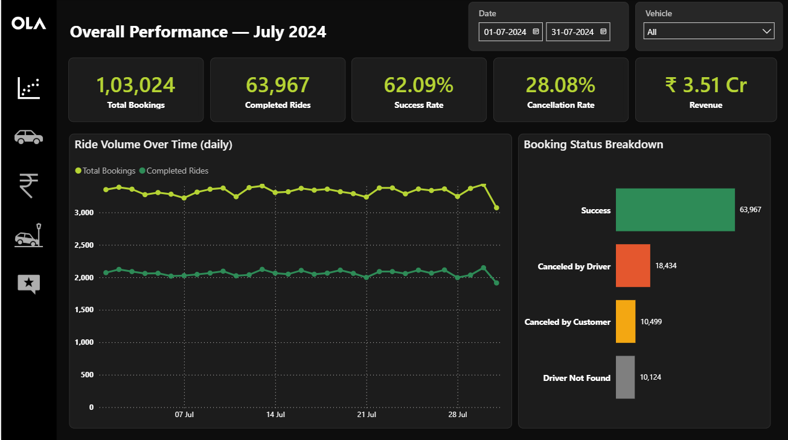
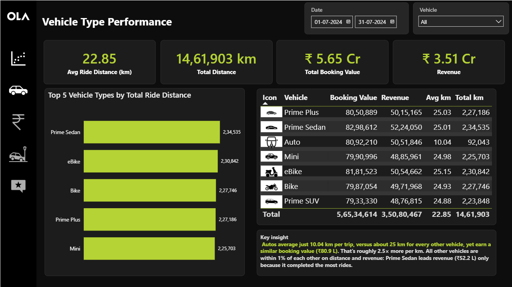
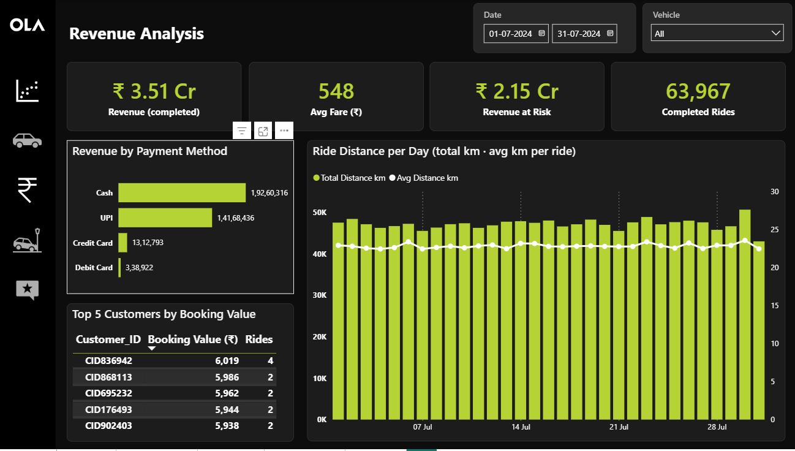
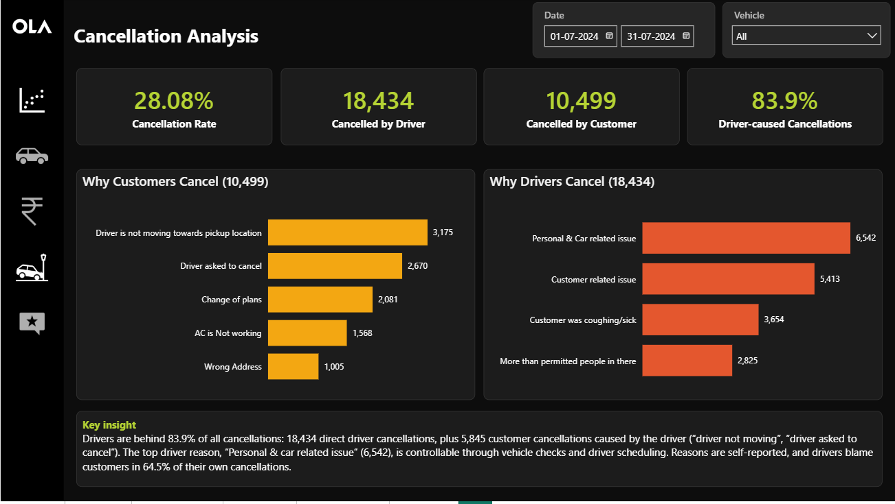
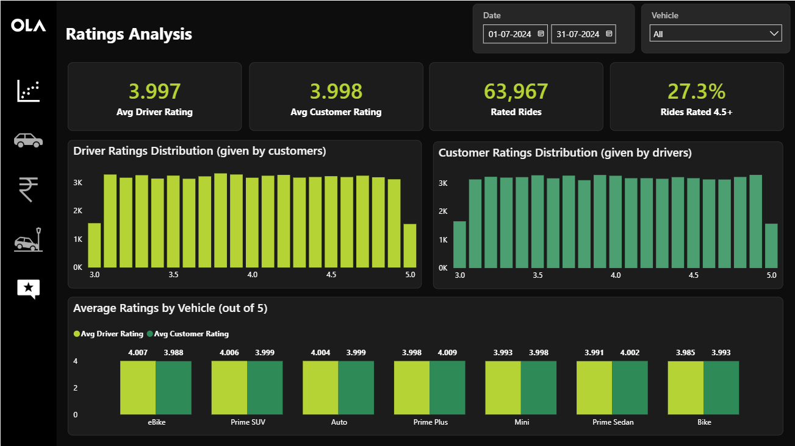

# 🚖 OLA Ride Insights

**End-to-end ride analytics for OLA Bengaluru (July 2024): Python → MySQL → Power BI → Streamlit.**
Labmentix Project 8 · Business / Data Analyst batch · by **Vipsa Patel**

| | Link |
|---|---|
| 🌐 **Live Streamlit app** | https://ola-ride-insights-v.streamlit.app/ |
| 📊 **Power BI report** | [`powerbi/OLA_Dashboard.pbix`](powerbi/OLA_Dashboard.pbix) + [page screenshots](powerbi/screenshots/) |
| 📄 **Documentation** | [`docs/OLA_Project_Documentation.pdf`](docs/OLA_Project_Documentation.pdf) |

> The Power BI report is shared as a `.pbix` file with screenshots, because publishing to the Power BI Service requires an organisational Microsoft account.

---

## 1. Business problem

OLA has a lot of raw ride data but does not know:

- When ride demand is highest
- Why rides are cancelled (by customers and by drivers)
- Which vehicle types customers use most
- How customers rate drivers, and how drivers rate customers
- Which payment method generates the most revenue

**Goal:** turn 103,024 bookings into clear answers that help improve customer satisfaction, driver allocation and revenue, and reduce cancellations.

---

## 2. Key results

| KPI | Value |
|---|---|
| Total bookings | **1,03,024** |
| Completed rides | **63,967 (62.09%)** |
| Cancellation rate (customer + driver) | **28.08%** |
| Driver Not Found (supply gap) | **10,124 (9.8%)** |
| Revenue (completed rides) | **₹3,50,80,467 (≈ ₹3.51 Cr)** |
| Quoted fares lost to failed bookings | **₹2,14,54,147 (≈ ₹2.15 Cr)** |
| Average ride distance (completed) | **22.85 km** |

The same KPIs give **identical numbers** in the notebook, MySQL, Power BI, TiDB Cloud and the live Streamlit app.

### Main findings
1. **Drivers drive cancellations.** Drivers cancel 17.9% of bookings, and more than half of customer cancellations are also driver-caused ("driver not moving", "driver asked to cancel"). Together, **83.9% of all cancellations trace back to drivers**.
2. **Cash still dominates.** Cash settles **54.8%** of completed rides, UPI **40.5%**, and cards under 5%. Average fares are the same for every method.
3. **Autos are the outlier.** Autos average **10.04 km** per trip versus about 25 km for every other vehicle, yet charge a similar fare, which is roughly 2.5× more per km.
4. **No meaningful difference** in demand across hours, days, vehicles or pickup locations, and ratings are identical for both sides (driver 3.997, customer 3.998).
5. **Data-quality flags:** fare is not linked to distance (correlation **0.002**), **3,591** completed rides cost more than ₹200/km, and **2,121** bookings have the same pickup and drop location.

> ⚠️ **Limitation:** the dataset is **synthetic** (uniform ratings, equal vehicle shares, fares independent of distance). Findings describe this data, not real OLA operations.

### Recommendations
1. Cut driver cancellations: live pickup tracking, alerts when a driver isn't moving, penalties for repeat cancellations.
2. Close the supply gap: driver positioning and incentives to reduce "Driver Not Found".
3. Audit the fare formula: fares must rise with distance and vehicle class (review Auto pricing first).
4. Vehicle checks to reduce "car related" and "AC not working" cancellations.
5. Shift cash riders to UPI with small incentives; track the cash share monthly.
6. Automatic anomaly alerts for rides above ₹200/km, plus a round-trip flag.

---

## 3. Architecture



- **Power BI** reads MySQL through a 64-bit **ODBC DSN**, never the Excel or CSV file.
- **Streamlit** reads MySQL / TiDB through **SQLAlchemy**, never the CSV.
- Passwords live in `.env` and `.streamlit/secrets.toml`, which are both git-ignored.

---

## 4. Tech stack

**Python** (pandas, NumPy, Matplotlib, Seaborn, Plotly) · **MySQL 8** · **TiDB Cloud Starter** · **SQLAlchemy + PyMySQL** · **MySQL Connector/ODBC** · **Power BI Desktop** (DAX, data modelling) · **Streamlit** · **Google Colab** · **Git/GitHub**

---

## 5. Repository structure

```
Ola-Ride-Insights/
├── README.md
├── requirements.txt              # used by Streamlit Cloud
├── .env.example                  # dummy DB settings (real .env is git-ignored)
├── .streamlit/
│   ├── config.toml               # dark OLA theme
│   └── secrets.toml.example      # dummy secrets (real file is git-ignored)
├── data/
│   ├── raw/OLA_DataSet.xlsx
│   └── processed/ola_cleaned.csv, vehicle_icons.csv
├── notebooks/OLA_EDA_Preprocessing.ipynb
├── pipeline/load_to_mysql.py     # loads local MySQL or TiDB (--tidb) + creates views + verifies
├── sql/ola_queries.sql           # 10 business questions + 8 reporting views
├── powerbi/
│   ├── OLA_Dashboard.pbix
│   ├── ola_theme.json
│   └── screenshots/              # 01_overall … 05_ratings
├── app/
│   ├── app.py                    # Streamlit pages and layout
│   ├── db.py                     # database connection + cached queries
│   ├── queries.py                # all SQL used by the app
│   └── assets/icons/             # OLA brand, navigation and vehicle icons
└── docs/OLA_Project_Documentation.pdf
```

---

## 6. SQL analysis (MySQL)

| # | Question | Result |
|---|---|---|
| 1 | All successful bookings | 63,967 rows |
| 2 | Average ride distance per vehicle type | Auto 10.04 km; all others 24.88–25.15 km |
| 3 | Rides cancelled by customers | 10,499 |
| 4 | Top 5 customers by rides booked | CID954071 (5 bookings) + 4 of the 26 customers tied at 4, ties broken by revenue, then Customer_ID |
| 5 | Driver cancellations for personal & car-related issues | 6,542 |
| 6 | Max / min driver rating for Prime Sedan | 5.0 / 3.0 |
| 7 | Rides paid by UPI | 25,881 rides · ₹1,41,68,436 |
| 8 | Average customer rating per vehicle | 3.988 (eBike) to 4.009 (Prime Plus) |
| 9 | Total booking value of successful rides | ₹3,50,80,467 |
| 10 | Incomplete rides with reason | 3,926: Customer Demand 1,601 · Vehicle Breakdown 1,591 · Other Issue 734 |

**8 reporting views** (`vw_overall_daily`, `vw_vehicle_summary`, `vw_revenue_payment`, `vw_top_customers`, `vw_daily_distance`, `vw_cancellation_reasons`, `vw_rating_distribution`, `vw_ratings_by_vehicle`) keep the business rules in one place for Power BI and Streamlit.

---

## 7. Power BI dashboard (5 pages)

| Overall | Vehicle Type | Revenue |
|---|---|---|
|  |  |  |

| Cancellation | Ratings |
|---|---|
|  |  |

---

## 8. Streamlit app (9 pages)

**Overall · Vehicle Type · Revenue · Cancellation · Ratings** (KPI cards in ₹ Lakh/Crore + Plotly charts) · **SQL Queries** (the 10 questions run live) · **Power BI** (screenshots + `.pbix` download) · **Insights & Anomalies** · **Data Explorer** (search + CSV download).
Sidebar filters (date range, vehicle type, time slot) update every chart.

---

## 9. How to run it locally (Windows / PowerShell)

```powershell
# 1. Clone and set up Python
git clone https://github.com/Vipsa2207/Ola-Ride-Insights.git
cd Ola-Ride-Insights
python -m venv .venv
.\.venv\Scripts\Activate.ps1
pip install -r requirements.txt

# 2. Database settings: copy the examples and fill in your own values
copy .env.example .env
copy .streamlit\secrets.toml.example .streamlit\secrets.toml

# 3. Load the cleaned data into MySQL (creates ola_db, the tables and the 8 views, then verifies)
python pipeline/load_to_mysql.py            # local MySQL
python pipeline/load_to_mysql.py --tidb     # optional: TiDB Cloud

# 4. Run the app
streamlit run app/app.py
```

Expected verification output: `total_rows 103,024 · successful 63,967 · revenue 35,080,467 · avg_km 22.85 → ALL CHECKS PASSED`.

---

## 10. Author

**Vipsa Patel**, B.Tech CSE (Data Science), ITM Vocational University, Vadodara
[LinkedIn](https://www.linkedin.com/in/vipsapatel) · [GitHub](https://github.com/Vipsa2207)# OLA Ride Insights
